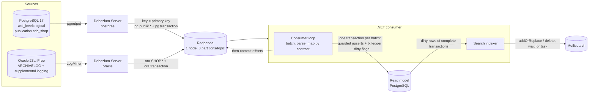

# cdc-pipeline

[](https://github.com/hekimcan206/cdc-pipeline/actions/workflows/ci.yml)
[](https://github.com/hekimcan206/cdc-pipeline/actions/workflows/codeql.yml)


[](LICENSE)

Change data capture from **Oracle (LogMiner)** and **PostgreSQL (pgoutput)** with Debezium Server and Redpanda, and a
.NET 10 consumer that projects every change into a **PostgreSQL read model** and a **Meilisearch index**. The
repository is about the parts that are usually hand-waved: what "at-least-once" costs and how to make it harmless,
which order is guaranteed and which is not, what a transaction boundary is worth downstream, and what happens to a
running consumer when someone renames a column.

All data in this repository is synthetic; there is no real personal or business data.

## The problem

A read model or search index fed by CDC is a copy of the system of record, and copies drift:

- Debezium republishes everything after its last flushed offset when it restarts; the consumer re-reads everything
  after its last committed offset when it crashes. Every change can arrive twice, and an old one can arrive after a new one.
- A snapshot row and a streamed change for the same key race; a transaction that started before the snapshot can carry
  an older LSN than the snapshot itself.
- An order and its lines are one source transaction, but they travel on three topics and several partitions.
- Columns get added, renamed and retyped while the pipeline runs, and the topic holds old and new shapes side by side.
- Oracle needs ARCHIVELOG mode, supplemental logging and a common user before LogMiner works at all, and the
  developer image starts without any of it.

## What it does

| Concern | How |
|---|---|
| Capture | Debezium Server 3.7.1, one instance per source: PostgreSQL 17 via `pgoutput` with a least-privilege publication; Oracle 23ai Free via LogMiner (`hybrid` strategy). Kafka sink into a single Redpanda node, 3 partitions per topic ([ADR 0001](docs/adr/0001-debezium-server-with-a-single-redpanda-node.md)) |
| Oracle setup | `gvenzl/oracle-free:23-slim-faststart` plus one init script: FRA, bounce to ARCHIVELOG, supplemental logging, `c##dbzuser`, schema. Zero manual steps in tests and compose ([ADR 0002](docs/adr/0002-oracle-logminer-on-oracle-23ai-free.md)) |
| Delivery | At-least-once: one read-model transaction per batch, then the offset commit. Redelivery is absorbed by a **guarded upsert keyed by primary key and ordered by source position** (PostgreSQL `lastCommitLsn`/`lsn`, Oracle `commit_scn`/`total_order`, snapshots below everything). Deletes are tombstones ([ADR 0003](docs/adr/0003-at-least-once-with-a-position-guarded-projection.md)) |
| Ordering | Per key: Debezium keys records by primary key, the broker keeps a key in one partition, batches are applied in partition order. Nothing is promised across keys |
| Transactions | BEGIN/END markers and per-event `total_order` reconcile into `rm_tx`, whichever arrives first; the search index holds back rows of incomplete transactions (bounded wait), so search never shows an order without its lines |
| Search | Meilisearch, fed from the read model through a dirty flag set in the same transaction (an outbox), so a crash can delay but never lose an index update ([ADR 0004](docs/adr/0004-meilisearch-indexed-from-the-read-model.md)) |
| Schema evolution | Versioned contracts: unknown fields kept in `extra` and searchable, aliases for renames, lossless coercion for type changes. An event that cannot be mapped **halts** the consumer without committing, with the event's coordinates ([ADR 0005](docs/adr/0005-versioned-contracts-and-fail-closed-schema-evolution.md), [docs/schema-evolution.md](docs/schema-evolution.md)) |
| Operations | `/health/live`, `/health/ready` (503 with the halt reason), `/stats`; OpenTelemetry metrics (`cdc.lag.read_model`, `cdc.events.skipped`, `cdc.halts`, ...), Serilog JSON |

## Architecture



One batch, end to end:

```mermaid
sequenceDiagram
    autonumber
    participant RP as Redpanda
    participant C as Consumer
    participant RM as Read model
    participant IX as Indexer
    participant MS as Meilisearch
    C->>RP: poll (up to 500 records, no wait once data is flowing)
    C->>C: parse envelopes, compute SourcePosition, map via contract (violation -> halt, nothing written)
    C->>RM: BEGIN; per change: INSERT .. ON CONFLICT DO UPDATE .. WHERE row.pos < change.pos;<br/>tx ledger + END counts; counters; COMMIT
    Note over C,RP: crash here = batch redelivered, every change hits the guard
    C->>RP: commit offsets
    C-)IX: wake
    IX->>RM: dirty rows whose source transaction is complete
    IX->>MS: push current state, wait for task
    IX->>RM: clear dirty flag where position unchanged
```

## Why this design

- **Debezium Server + Redpanda instead of Kafka Connect + Kafka.** One small JVM per source and one C++ broker process
  instead of two JVMs and three internal topics; it is the difference between fitting next to an Oracle database on a
  7.6 GB VM or not. The consumer only sees the Kafka protocol, so swapping in Kafka changes nothing in the code.
- **A position guard instead of a dedup ledger.** The broker offset is not a stable identity (Debezium republishes
  under new offsets), but the source position is, and comparing it per row needs no extra table and no extra write.
  The ordering argument (writers of one row are serialised by the database) is written down in ADR 0003 and checked by
  a model-based property test and by hard-kill integration tests.
- **The index is a projection of the read model, not of the stream.** It makes the index crash-safe for free and lets
  transaction completeness gate visibility without buffering events in the consumer.
- **Fail closed on schema drift.** Skipping an unmappable event would break per-key ordering for every later change of
  that row; writing nulls would corrupt it. A halt with the exact event coordinates is loud and recoverable.
- **Meilisearch over OpenSearch.** The lighter engine for typo-tolerant search with filters; the read model already
  answers analytical queries in SQL.

## Quick start

```bash
docker compose up            # PostgreSQL pipeline + scripted demo; `docker compose logs demo` prints the JSON verdict
curl localhost:58080/stats   # consumer counters; read model on localhost:56433, Meilisearch on localhost:57700

docker compose --profile oracle up -d oracle debezium-oracle   # add the Oracle LogMiner pipeline (about 3 GB more)
```

Tests (Docker running):

```bash
dotnet test                                                        # unit + PostgreSQL pipeline end to end
CDC_ORACLE_TESTS=1 dotnet test --project tests/CdcPipeline.IntegrationTests -- --filter-class "*OraclePipelineTests"
dotnet run -c Release --project benchmarks/CdcPipeline.Bench -- pg # or: oracle
```

## Tests

| Suite | What it proves |
|---|---|
| Golden (`DebeziumParserGoldenTests`) | Real Debezium 3.7.1 output from both connectors (snapshot, transaction, update, delete, add/rename/type change) parses to a committed canonical form |
| Property (FsCheck) | Random crash schedules over random workloads converge to the exactly-once state with every change applied once; positions form a total order; integer coercion never truncates |
| Contract | v1 and v2 against the captured evolution events of both databases: extra, alias, lossless widening, halt on lossy or missing |
| Read model (Testcontainers PostgreSQL) | Whole-history replay changes nothing; an older change never overwrites a newer one; tombstones resist resurrection; transaction completeness in either arrival order; a violation writes nothing |
| PostgreSQL pipeline (Testcontainers: source PostgreSQL, Redpanda, Debezium Server, read-model PostgreSQL, Meilisearch) | End to end incl. search; replaying the entire topic into a populated read model re-applies 0 changes; **consumer killed repeatedly between DB commit and offset commit, plus Debezium killed mid-run: read model equals source, `apply_count == version` for every row, index holds exactly the live rows**; live ADD/RENAME/TYPE change with v1 halting and v2 resuming from the same offset |
| Oracle pipeline (opt-in, own CI job) | Mixed workload across a hard consumer kill reconciles row for row with exact apply counts; ADD, RENAME and an expand/contract type change through LogMiner |

## Results

Measured on an i7-13620H laptop, Docker Desktop VM with 7.6 GB shared with another project; one run per row, Release
build. Lag is per row from the source row's `updated_at` (source DB clock) to `applied_at` / `indexed_at` (read-model
DB clock), same VM kernel clock. Method, environment and raw JSON: [docs/benchmarks.md](docs/benchmarks.md).

| Source | Offered load | Commit → read model p50 / p95 / p99 | Commit → search index p50 / p95 / p99 |
|---|---|---|---|
| PostgreSQL | 50 ops/s (71 changes/s) | 255 / 455 / 557 ms | 356 / 573 / 679 ms |
| PostgreSQL | 200 ops/s (281 changes/s) | 311 / 543 / 1,124 ms | 513 / 1,876 / 2,589 ms |
| PostgreSQL | 500 ops/s (699 changes/s) | 277 / 409 / 517 ms | 733 / 1,100 / 1,281 ms |
| Oracle | 25 ops/s (37 changes/s) | 2,004 / 3,705 / 3,864 ms | 2,231 / 3,884 / 4,004 ms |
| Oracle | 100 ops/s (140 changes/s) | 2,221 / 3,584 / 3,941 ms | 2,595 / 3,864 / 4,247 ms |
| Oracle | 200 ops/s (281 changes/s) | 2,421 / 3,651 / 3,999 ms | 2,835 / 4,026 / 4,359 ms |

| Consumer downtime | Backlog | Read model caught up | Index caught up | Drain rate |
|---|---|---|---|---|
| PostgreSQL, 30 s at 300 ops/s | 12,476 events | 9.56 s | 10.46 s | 1,305 events/s |
| Oracle, 30 s at 150 ops/s | 6,301 events | 6.74 s | 7.71 s | 934 events/s |

Crash test: consumer killed between read-model commit and offset commit every 10th batch of 50 plus random external kills,
Debezium killed once mid-run, 1,500 operations: read model equal to the source, every row applied exactly `version`
times, index holding exactly the live rows. Memory after the PostgreSQL run: Debezium 386 MiB, Redpanda 126 MiB,
Meilisearch 94 MiB, read model 91 MiB; the Oracle database alone 3,005 MiB.

## Limitations and next steps

- **Single broker node, no replication**; offsets of Debezium Server in a file on a volume. Production needs three
  brokers and replicated offsets (or Redis/JDBC offset storage).
- **Ordering is per row only.** A consumer that needs cross-row invariants (an order total equal to the sum of its
  lines) must read through `rm_tx` completeness or wait for the index, which is transaction-gated.
- **Re-snapshots** (lost Debezium offsets) require rebuilding the read model; snapshot rows never overwrite streamed
  rows by design. Not automated.
- **Oracle**: Debezium's LogMiner adapter has a known issue with ROLLBACK TO SAVEPOINT on index-organised tables
  (debezium/dbz#2785); the demo schema uses heap tables and no savepoints. Online redo logs are 10 MB on the Free image;
  enlarge them for real load. In-place scale changes on non-empty NUMBER columns are refused by Oracle (expand/contract
  instead, documented).
- **Consumer drain rate is about 1,300 events/s** (one guarded upsert per change, one round trip per batch). A
  set-based upsert per batch (deduplicate per key, then one `INSERT ... SELECT FROM unnest(...)`) is the next step.
- **LogMiner lag is about 2 s p50** with untuned mining settings and the Free image's 10 MB redo groups.
- **Type changes on PostgreSQL need the connector caught up first**: Debezium 3.7.1 stopped when an `ALTER COLUMN
  TYPE` overtook it (docs/schema-evolution.md).
- **One consumer instance per group** is what is tested. Several instances work by the same argument (partitions are
  exclusive within a group and the guard absorbs rebalance redelivery) but are not exercised by the suite.
- **Tombstones keep personal data** of deleted rows; a purge job for rows older than the replay window is described in
  the threat model, not implemented.
- **OpenSearch was not measured** on this machine; the engine choice rests on Meilisearch's measured footprint and
  OpenSearch's documented sizing.

## Privacy note (KVKK)

The demo schema holds names and e-mail addresses, all synthetic. A CDC copy of real personal data carries the same
obligations as the source under KVKK (Turkey's Personal Data Protection Law, comparable to the GDPR): project only the
columns the read model needs, bound retention in topics and tombstones, and control access to every copy.
[docs/threat-model.md](docs/threat-model.md) lists the concrete controls.

## License

MIT, see [LICENSE](LICENSE).
