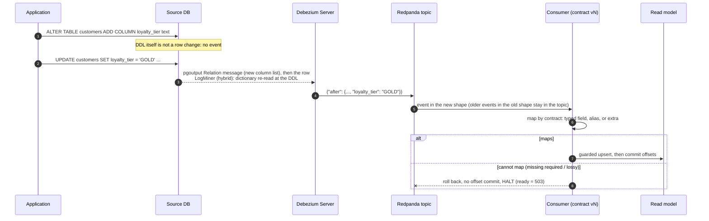
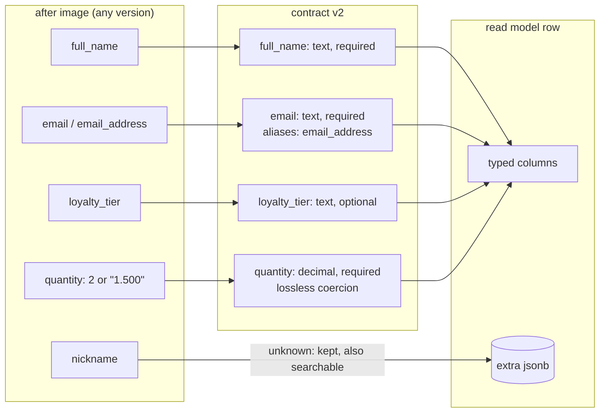
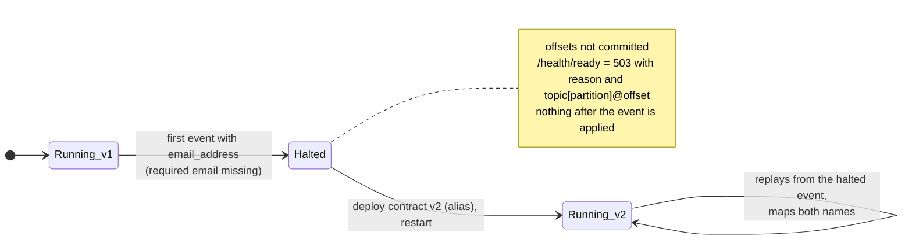
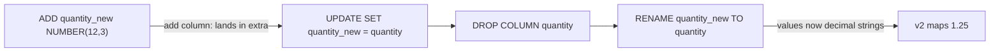

# Schema evolution

Three changes are made to the source while the pipeline runs: **add a column**, **rename a column**, **change a
type**. This page shows what each one looks like on the wire, how consumers on contract v1 and v2 react, and in which
order to roll a change out. Every claim here is backed by a test on real connector output:

- `tests/CdcPipeline.UnitTests/Contracts/SchemaEvolutionTests.cs` replays events captured from Debezium 3.7.1 for both
  PostgreSQL (pgoutput) and Oracle 23ai Free (LogMiner, `hybrid` strategy) through both contract versions.
- `tests/CdcPipeline.IntegrationTests/SchemaEvolutionTests.cs` runs the DDL live on PostgreSQL while consumers run.
- `tests/CdcPipeline.IntegrationTests/OraclePipelineTests.cs` does the Oracle version, including expand/contract.

## How a schema change travels



Debezium emits the new shape from the first row change after the DDL; the DDL statement produces no data event
(`include.schema.changes=false`). With `schemas.enable=false` the event carries no schema, so the consumer maps by field
name, which is exactly what the contract is for.

## The contract



| Rule | Behaviour |
|---|---|
| Unknown field | stored in `extra` and merged into the search document; never an error |
| Alias | old and new name both accepted; both present at once is an error (ambiguous) |
| Required field missing or null | halt |
| Lossy conversion (fraction into integer, out of range) | halt |
| Delete | only the key is mapped (the before-image can hold type defaults) |

## 1. Add a column

```sql
ALTER TABLE customers ADD COLUMN loyalty_tier text;      -- PostgreSQL
ALTER TABLE customers ADD (loyalty_tier VARCHAR2(20));   -- Oracle
```

Events after the change carry `loyalty_tier`; events before it do not.

| Consumer | Event without the column | Event with the column |
|---|---|---|
| v1 (does not know it) | maps | maps; `loyalty_tier` goes to `extra` and is searchable |
| v2 (optional typed field) | maps, column is NULL | maps into `rm_customer.loyalty_tier` |

**Safe in any order.** Adding a nullable column never breaks a consumer. Adding a `NOT NULL` column with a default is
also safe for this consumer; making a new field *required* in the contract must wait until no older event can be
replayed (topic retention).

Promoting a field from `extra` to a typed column later: add the column in a read-model migration, release the contract
version that knows it, and backfill rows written before the promotion:
`UPDATE rm_customer SET loyalty_tier = extra->>'loyalty_tier', extra = extra - 'loyalty_tier' WHERE extra ? 'loyalty_tier'`.

## 2. Rename a column

```sql
ALTER TABLE customers RENAME COLUMN email TO email_address;
```

The topic now holds `email` in old events and `email_address` in new ones.



| Consumer | Old event (`email`) | New event (`email_address`) |
|---|---|---|
| v1 | maps | **halts**: `MissingRequiredField customer.email` |
| v2 (`email` with alias `email_address`) | maps | maps |

v1 halting is the intended outcome. The alternatives are worse: treating the field as null would blank the email of
every customer who changes anything; skipping the event would leave the row behind its source and break per-key
ordering for every later change of that customer.

**Rollout order:** release the consumer with the alias first, then rename in the source. Keep the alias until the
topic no longer holds old events. The integration test also renames the column back at the end, and v2 does not
notice: aliases work in both directions.

## 3. Change a type

### PostgreSQL: in place

```sql
ALTER TABLE order_lines ALTER COLUMN quantity TYPE numeric(12,3);
```

With `decimal.handling.mode=string`, integer `quantity` arrives as the JSON number `2` before the change and as the
string `"1.500"` after it (and `"2.000"` for whole values).

| Consumer | `2` | `"2.000"` | `"1.500"` |
|---|---|---|---|
| v1 (`quantity: Int32`) | 2 | 2 (lossless) | **halts**: `LossyConversion order_line.quantity` |
| v2 (`quantity: Decimal`) | 2 | 2.000 | 1.500 |

Widening is harmless until a value actually needs the new range; then a v1 consumer halts instead of truncating 1.5 to
1 or 2. The read-model column is `numeric(14,3)` from the start, so v2 needed no migration.

#### Pitfall found while building this: the connector must have caught up before `ALTER COLUMN ... TYPE`

The first version of the integration test ran the three DDL statements straight after the inserts, while Debezium was
still decoding them. The PostgreSQL connector (3.7.1) then stopped for good:

```
WARN  TableSchemaBuilder  Failed to properly convert data value for 'public.order_lines.quantity' of type numeric:
      java.lang.IllegalArgumentException: Unexpected value for JDBC type 4 ...
ERROR ErrorHandler        Producer failure: ... Error while processing event at offset {transaction_id=751, ...}
ERROR DefaultDebeziumServerLifecycle  Debezium engine completed with a failure
```

pgoutput decodes old WAL with the catalog of its time (the order line still holds an `integer`), but the connector
refreshes its table schema from the *current* catalog (`numeric`) and cannot convert the old value. No event was
published past that point, so nothing was lost or corrupted downstream; the pipeline simply stopped and the consumer
stayed `running` with nothing to read. Whether a plain restart recovers was not tested here. The rule the test now
follows, and the one to follow in production: **let the connector catch up on a table before changing a column type on
it** (pause writers or wait until the change before the DDL is visible downstream). Adding and renaming columns did not
need this; the rename only produced `Column 'email' optionality could not be determined, defaulting to true`.

### Oracle: expand/contract

Oracle refuses an in-place scale change on a non-empty column:

```
ALTER TABLE order_lines MODIFY (quantity NUMBER(12,3))
ORA-01440: column to be modified must be empty to decrease precision or scale
```

So the type change is an expand/contract migration, and each step is one of the cases above:



Between `DROP` and `RENAME` a row event would have no `quantity` at all, and v2 would halt on it (required field).
Run the two statements back to back with no DML in between (the test does), or give the contract a temporary alias
`quantity_new` for the window.

## Rollout checklist

1. Classify the change: additive (add nullable column, widen) or breaking (rename, drop, narrow, type change that can
   produce values the old type cannot hold).
2. Additive: change the source; release a contract version later if the field should become typed.
3. Breaking: release the consumer whose contract accepts both shapes **first**; then change the source.
   For a type change on PostgreSQL, make sure Debezium has caught up on that table before the `ALTER` (see the pitfall
   above); otherwise the connector stops.
4. Watch `cdc.halts` and `/health/ready`. A halt names the event (`topic[partition]@offset`) and the field. Fix the
   contract, redeploy, and the consumer resumes from that exact event.
5. Remove aliases only after the topic retention has passed since the change.
